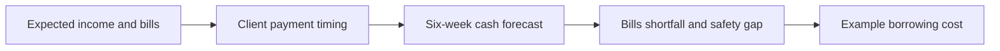

# Tide

**TrojanHacks 2026 · Finance vertical**

**Team:** Aeden Gray and Stavya Palassery

Tide helps freelancers with irregular client income answer a specific question: **If an invoice arrives late, can I still pay my bills, and do I need to borrow?**

[Try the live demo without an account](https://tide-36b83.web.app/?demo=1) · [Open the public site](https://tide-36b83.web.app/) · [Judge presentation](https://docs.google.com/presentation/d/1Ei81xYIQAvsQOQgqsvGr2yUGeKmQZ4CG_t2jtDZReuE)

## The 60-second walkthrough

1. Open the live demo. The sample plan starts with a **$7,700** lowest projected balance after bills and a **$5,000** safety amount.
2. Click **Delay Atlas payment**. Tide moves a **$6,200** client invoice two weeks later and redraws the six-week cash comparison. The lowest projected balance falls to **$3,700**.
3. Click **See borrowing decision**. Bills still have a **$0 shortfall**, while the plan is **$1,300 below the chosen safety amount**. The loan calculator starts at that gap and shows example repayment and interest costs.
4. Return to **Client payments** to draft a friendly reminder that can be copied into email. Tide does not send it automatically.

The guest demo uses sample data and does not save changes. Email/password and Google sign-in are available for a private plan saved to Cloud Firestore.

## Why the parts belong together



The app keeps one plan object. `setInvoiceStatus()` changes when a receipt arrives; `forecast()` carries cash forward after income and bills; `getPlanSummary()` identifies the lowest balance and gaps; `calculateLoan()` estimates repayment for an amount, APR, and term. Changing an upstream input changes the later answer.

## What works today

- Add and update expected client payments and bills.
- Mark an invoice late or paid, change its expected week, and copy a reminder draft.
- Edit starting cash, other income, weekly bills, the plan start date, and the safety amount.
- See weekly cash balances and compare a sample invoice on time versus delayed.
- Compare a loan amount, APR, term, monthly payment, total repayment, and interest.
- Sign in with Firebase Authentication and save a private plan in Firestore. Offline changes remain in a browser cache until online saving works.
- Use the responsive guest demo on desktop or mobile. Motion respects the device's reduced-motion setting.

Tide is a hackathon prototype. It does not connect to banks, predict actual payment dates, send payments or reminders, offer loans, or include lender-specific fees in its example loan figures. It has not been tested for measured user impact.

## Tech stack

React 19, Vite 7, Tailwind CSS 4, Firebase Authentication, Cloud Firestore, and Vitest. Firebase Hosting serves the public site.

## Run locally

```bash
npm ci
npm test
npm run dev
npm run build
```

The web app config for the hackathon Firebase project is in `src/firebase.js`. To use another Firebase project, copy `.env.example` to `.env.local` and set the four `VITE_FIREBASE_*` values. Enable Email/Password and Google sign-in, authorize your hosting domain, create Firestore, and publish `firestore.rules`. Those rules restrict each `users/{uid}` document to its owner. Never add a service-account key to client code.

## Repository map

- `src/plan.js` — forecasting and loan math
- `src/DemoImpact.jsx` — interactive comparison driven by the same plan
- `src/App.jsx` — the four-step workspace
- `src/Auth.jsx` — Firebase sign-in and plan persistence
- `firestore.rules` — owner-only Firestore access
- `src/*.test.*` — math, persistence, and workflow checks
